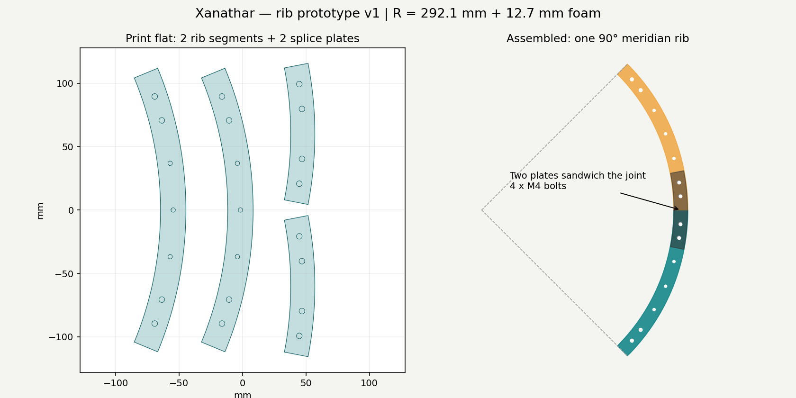

# Meridian rib prototype v1

Units: **millimetres**. Geometrically checked. **First print and sandwich-splice fit passed**, per builder report on October 11, 2026; **not load-tested**. Supports lightweight foam/cosmetics only; not the eye motor mount or suspension hardware.

## Print tonight

Open **one-rib-kit.stl** in Bambu Studio as a single flat arrangement. It contains 2 separate 45-degree rib segments and 2 splice plates, all with bottoms on Z=0. If imported as one object, “Split to objects” allows individual selection. Keep flat and at **100% scale**. Do not use “fit to bed” scaling.

Footprint: **142.36 × 231.28 × 8 mm**, before brim. Nominal X1C volume is 256 × 256 × 256 mm ([Bambu specifications](https://public-cdn.bambulab.com/store/X1-Carbon%20tech%20specs.pdf)). Center the arrangement, check the printer profile's exclusion/calibration zones and all startup lines in the slicer. No need to override printer limits. A small brim is optional; verify the complete footprint.

Suggested starting settings; the successful print's actual settings and filament have not yet been reported:
- Existing PLA for a sheltered, cool display, or PETG using its appropriate preset.
- Standard 0.4 mm nozzle; 0.20 mm layer height.
- 4 walls; 5 top/bottom layers; 25% gyroid infill.
- No supports; broad 20 mm curved faces on the bed.
- Preview every layer and use Bambu Studio's time/filament estimate. No G-code is supplied.

To test just the curve, print **rib-45deg.stl** once. For one assembled quarter rib, print 2 segments plus 2 copies of **splice-plate.stl** (or the kit once).

## Joint hardware and assembly

Per joint: **4 M4 × 25 mm bolts, 4 M4 nuts (nylon locknuts if available), and 8 washers**. Prototype holes are 4.5 mm; clean or drill to fit as necessary. Bolts pass through both plates and one rib, not through both rib segments.

1. Put the two rib segments on a flat surface, continuing the same curve, with their square end faces touching.
2. Center one curved splice plate on each side of the joint, on the broad flat faces.
3. Align all four holes: two are on each side of the seam.
4. Install the four bolts with washers/nuts. Snug gently; do not crush plastic.
5. Check that the assembled rib remains flat and the joint does not slip.
6. Drape a scrap of foam over the outer edge. Check for visible ridges and excessive deflection.
7. Leave remaining end holes available for later rear-ring/front-form brackets.

The sandwich is 3 + 8 + 3 = **14 mm** thick before washers and nuts. M4 × 25 permits a locknut and washers; verify actual engagement and cover protruding ends. Smaller 3.5 mm holes along the rib are optional attachment holes for thin ties/thread, not bolt positions.

## Geometry and math

Finished nominal radius = 24 × 25.4 / 2 = **304.8 mm**.
Subtract half-inch foam: outer rib radius = 304.8 − 12.7 = **292.1 mm**.
Inner radius = **272.1 mm**, giving a 20 mm radial depth.
Extruded width = **8 mm**.

Each segment sweeps 45 degrees. Two make **one 90-degree arc from the rear equator toward the forward pole**, not half of an entire circumference. The foam-covered envelope is nominally 24 inches across; facial features can project beyond it.

A segment's outer chord is 2R sin(45°/2) = **223.564 mm**. Rotating it so its mid-angle points along X gives a compact bounding rectangle **40.712 × 223.564 mm**. This is why it fits the bed despite a 292.1 mm radius.

The plates sweep 22 degrees with bolt centers at −8°, −4°, +4°, +8° about the seam. Rib hole positions match those centers exactly at assembly. Two bolts per segment prevent a single-bolt hinge.

## This is a prototype rib, not a complete frame

The rear ring, crosspiece, attachment brackets, circumferential braces, and eye/mouth surrounds are not designed here. A rib is relatively flexible sideways until supported as part of a frame. Do not mass-print a whole cage before the first joint and foam test.

Ribs need not all meet at one pole. Eye and mouth openings interrupt the hemisphere: terminate ribs at their rigid surrounds or generate shorter pieces once placement is measured. Do not route a rib through the eye's motion envelope.

## Plywood alternative

The user is comfortable cutting plywood. Printing is optional and useful only when unattended production saves hands-on work.

**rib-45deg-template.svg** is a full-size cutting/drilling profile. **splice-template.svg** matches it. Print at 100% / actual size and measure the **25.4 mm calibration bar** before transferring. Browser print scaling may be wrong. Use an SVG-capable application or tile printing if needed. Templates have no saw-kerf allowance: cut outside the line, finish to it, and verify holes.

With wood, consider drawing a single unjointed 90-degree arc using 292.1 and 272.1 mm radii, eliminating the intermediate splice entirely. Actual plywood thickness determines brackets and bolt length; 8 mm is only the printed version's thickness.

## Validation and reproducibility

Run `python -m pip install -r requirements.txt`, then `python generate.py`.
The editable Python source generates the STLs, templates, preview, and validation.json.

Validation reimports exported STLs and checks watertightness, winding, positive volume, nondegenerate faces, two faces per edge, component counts, bed bounds, and bolt-center alignment. It also compares rib volume with the analytic annular-sector-minus-holes volume (within 0.1%). These checks do not prove strength, printer tolerances, coating behavior, or physical fit.

The kit's solid geometry is 81.391 cm³, roughly 101 g if completely solid PLA at an assumed 1.24 g/cm³. Actual sliced mass depends on walls/infill; record that value and print duration instead of treating this as a slicer estimate.

## Physical test log

October 11, 2026, 10:47 PM CDT: builder reports the first print finished successfully, the rib assembles nicely, and the sandwich braces fit. A second print is underway. No dimensional changes requested. Actual settings, filament, hardware details, print time/mass, foam support, and load performance have not been reported. The generated validation.json describes the original computational validation, not this later physical test.
